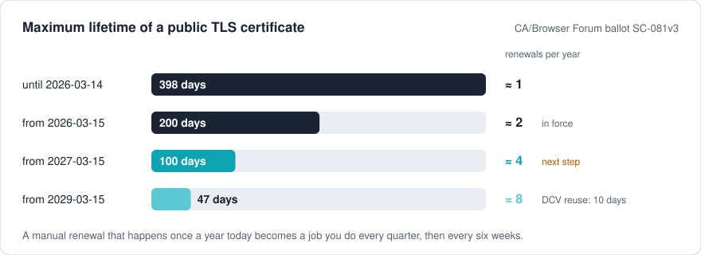
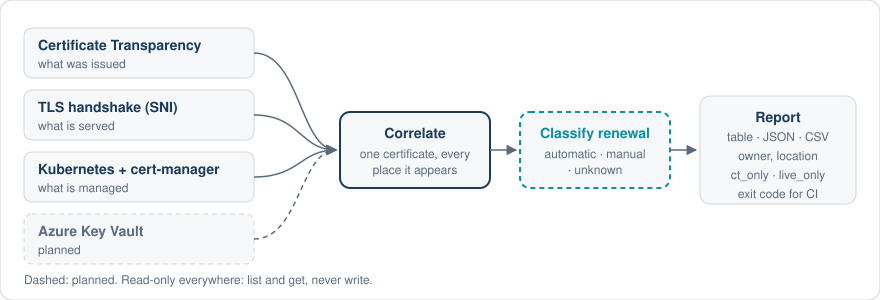

<p align="center">
  <picture>
    <source media="(prefers-color-scheme: dark)" srcset="docs/assets/scadenza-logo-dark.svg">
    
  </picture>
</p>

<h3 align="center">Which of your public TLS certificates will not survive 100-day lifetimes?<br>
An open-source CLI that finds every certificate, where it lives and who renews it.</h3>

<p align="center">
  <a href="https://github.com/HarnageaGabriel/scadenza/actions/workflows/ci.yml">
    </a>
  <a href="go.mod">
    </a>
  <a href="LICENSE">
    </a>
  <a href="https://scorecard.dev/viewer/?uri=github.com/HarnageaGabriel/scadenza">
    </a>
  
</p>

<p align="center">
  <a href="#try-it-now">Try it now</a> ·
  <a href="#why-now">Why now</a> ·
  <a href="#design-goals">Design goals</a> ·
  <a href="#status">Status</a> ·
  <a href="#how-it-works">How it works</a> ·
  <a href="#getting-started">Getting started</a> ·
  <a href="#roadmap">Roadmap</a> ·
  <a href="#contributing">Contributing</a>
</p>

<p align="center">
  <picture>
    <source media="(prefers-color-scheme: dark)" srcset="docs/assets/readme-hero-dark.svg">
    
  </picture>
</p>

**scadenza** (Italian for "expiry" or "deadline") inventories the public TLS
certificates of an organization. For each certificate it tells you **where it
is**, **who owns it** and **whether its renewal is automatic**, so you can fix
the manual ones before renewals have to happen four times a year.

It merges sources that existing open-source scanners look at one at a time:
Certificate Transparency logs (what was issued), live TLS handshakes (what is
served) and Kubernetes with cert-manager (what is managed). Azure Key Vault is
planned. Certificates are correlated by fingerprint: one certificate, every place
it appears. scadenza is free software under Apache-2.0 and will stay free.

> [!WARNING]
> scadenza is **pre-alpha**. There is no tagged release yet, and the JSON
> schema may still change before 0.1.0. Renewal classification (automatic,
> manual, unknown) is not implemented yet; today scadenza reports where
> certificates are and how long they live.

## Try it now

List the certificates issued for a domain, from Certificate Transparency logs.
No configuration and no account needed:

```sh
go install github.com/HarnageaGabriel/scadenza/cmd/scadenza@latest
scadenza ct example.com
```

```text
NOT BEFORE  NOT AFTER   DAYS  100D  FINGERPRINT SHA256  ISSUER                                          NAMES
2026-09-26  2026-12-25  90    ok    85ca6ab068e9…       Cloudflare TLS Issuing ECC CA 3 (SSL.com)       *.example.com, example.com
2026-09-26  2026-12-25  90    ok    8355fddfbed7…       Cloudflare TLS Issuing RSA CA 3 (SSL.com)       *.example.com, example.com
2026-09-24  2026-12-21  88    ok    56a7acf53c6f…       Sectigo Public Server Authentication CA DV E36  *.example.com, example.com
```

Output abbreviated. `DAYS` is the certificate lifetime and `100D` says whether
it already fits the 100-day limit. Add `--format json` or `--format csv` for
machines. Then compare what was issued with what is actually served:

```sh
scadenza scan --domain example.com
```

## Why now

The CA/Browser Forum ([ballot SC-081v3](https://cabforum.org/2025/04/11/ballot-sc081v3-introduce-schedule-of-reducing-validity-and-data-reuse-periods/))
is shortening the maximum lifetime of public TLS certificates:

| From | Maximum lifetime | Domain validation reuse | Renewals per year |
|---|---|---|---|
| 2026-03-15 | 200 days | 200 days | about 2 |
| **2027-03-15** | **100 days** | **100 days** | **about 4** |
| 2029-03-15 | 47 days | 10 days | about 8 |

A renewal done by hand once a year becomes a recurring job. The rules apply to
publicly trusted certificates only; private PKI is out of scope for the
calendar. The first scadenza release is planned for **February 2027**, before
the 100-day step.

## Design goals

What scadenza is being built to do; the [status table](#status) shows what
exists today.

- **Answer one question.** Will this certificate's renewal keep up with the new
  pace? Not a generic scanner, not a renewal tool: cert-manager and certbot
  already renew, scadenza tells you what is missing.
- **Many sources, one inventory.** Certificate Transparency, TLS handshakes,
  Kubernetes, cert-manager and one cloud at a time, correlated by fingerprint.
- **Never guess.** Owners come only from labels, annotations, namespaces or a
  mapping file you write. What scadenza cannot determine is reported as
  unknown, never inferred.
- **Read-only and scoped.** Only the domains and hosts you name are scanned;
  no IP ranges. Cluster and cloud access uses `list` and `get` only. Private
  keys are never decoded, logged or kept.
- **Deterministic.** The same input gives the same output. No AI in the main
  path.
- **Local and private.** One Go binary, no container runtime, no telemetry, no
  mandatory external service.
- **Built for CI.** Human tables, stable versioned JSON, CSV, and
  [documented exit codes](docs/exit-codes.md). Every problem has a stable
  [`SCD-` diagnostic code](docs/diagnostics/README.md) with its own page.

## Status

| Component | Status | Milestone |
|---|---|---|
| Foundations: CLI, diagnostics registry, clock, HTTP client with rate limiting, CI | Done | M0 |
| `scadenza ct`: Cert Spotter and crt.sh, table / JSON / CSV | Done | M1 |
| `scadenza scan`: TLS handshakes with SNI, fingerprint correlation, `ct_only` / `live_only` | Done | M2 |
| Kubernetes TLS Secrets and cert-manager `Certificate` resources, ownership mapping | Done | M3 |
| Reliable results: coverage, `--strict`, `--fail-on`, dated time rules, JSON contract tests | Done | M4a |
| Renewal classification with evidence: mode (automatic, manual, unknown) and health | Planned | M4b |
| Kubernetes without reading Secrets by default; Azure Key Vault | Planned | M5 |
| Releases: GoReleaser, Homebrew, krew | Planned | M6 / 0.1.0 |

## How it works

<p align="center">
  <picture>
    <source media="(prefers-color-scheme: dark)" srcset="docs/assets/readme-flow-dark.svg">
    
  </picture>
</p>

1. **Collect.** Certificate Transparency says what was issued for your
   domains. TLS handshakes, with SNI, say what each host actually serves.
   Kubernetes Secrets and cert-manager resources say what is managed, by whom
   and with which issuer.
2. **Correlate.** Certificates are matched by SHA-256 fingerprint, so one
   certificate shows every place it appears.
3. **Compare.** Issued but not served is `ct_only`; served but not issued
   under your domains is `live_only`. A name scadenza did not actually check
   (a wildcard, a host over the limit, a failed probe) is `not_checked`, never
   a finding.
4. **Report.** Table, JSON or CSV, with an exit code you can gate CI on.

Design decisions are recorded as [ADRs](docs/adr/).

## Getting started

Requires Go 1.26.5 or later until the first release ships binaries.

```sh
go install github.com/HarnageaGabriel/scadenza/cmd/scadenza@latest
```

Common commands:

```sh
# Certificates issued for a domain
scadenza ct example.com --format json

# Issued versus served, for the domain and the hosts found in CT logs
scadenza scan --domain example.com --host api.example.com:8443

# Add a Kubernetes cluster (read-only) and an ownership file
scadenza scan --domain example.com --kube --kube-context prod --ownership-file owners.yaml

# Fail CI on an incomplete scan, or only on selected findings
scadenza scan --domain example.com --strict --min-coverage 90 --fail-on live_only

# Read everything from an explicit configuration file
scadenza scan --config scadenza.yaml
```

Reference: [`ct`](docs/cli/ct.md), [`scan`](docs/cli/scan.md),
[configuration](docs/configuration.md), [ownership](docs/ownership.md),
[exit codes](docs/exit-codes.md), and the minimal
[read-only RBAC](deploy/rbac/scadenza-readonly.yaml) for clusters.

Cert Spotter answers a limited number of requests without an account. For
regular use, set an API key in `SCADENZA_CERTSPOTTER_KEY`; it is never
accepted as a flag and never logged.

## Roadmap

The plan to 0.1.0 is recorded in [ADR 0006](docs/adr/0006-roadmap-to-0.1.0.md).

- **M4a, reliable results.** A partial scan must never look like a clean one:
  coverage is reported, `--strict` and `--min-coverage` fail incomplete scans,
  and `--fail-on` chooses which findings fail CI.
- **M4b, renewal classification.** Automatic, manual or unknown, plus whether
  automatic renewal is healthy, with the evidence for each answer. Automatic
  renewal configured in a way that breaks under short lifetimes is a finding.
- **M5, Kubernetes and cloud.** Kubernetes without reading Secret data by
  default, then Azure Key Vault with read-only credentials.
- **M6, 0.1.0.** Binaries built with GoReleaser on GitHub Releases, Homebrew,
  checksums and CI examples.

Out of scope: renewing certificates, passive network capture, a web dashboard
and expiry calendars for private PKI.

## Contributing

Contributions are welcome. Looking for a place to start? See the [good first issues](https://github.com/HarnageaGabriel/scadenza/labels/good%20first%20issue) and the [help wanted](https://github.com/HarnageaGabriel/scadenza/labels/help%20wanted) ones. Read [CONTRIBUTING.md](CONTRIBUTING.md) (commits
need a DCO sign-off) and [CONVENTIONS.md](CONVENTIONS.md). Report security
issues privately as described in [SECURITY.md](SECURITY.md). This project
follows the [Code of Conduct](CODE_OF_CONDUCT.md).

scadenza belongs to a family of tools that help organizations get through a
migration forced by an external deadline, alongside
[trasloco](https://github.com/HarnageaGabriel/trasloco).

## License

[Apache-2.0](LICENSE). Free forever: no paid edition and no locked features.
The "scadenza" name and logo are covered by the [trademark policy](TRADEMARKS.md).
